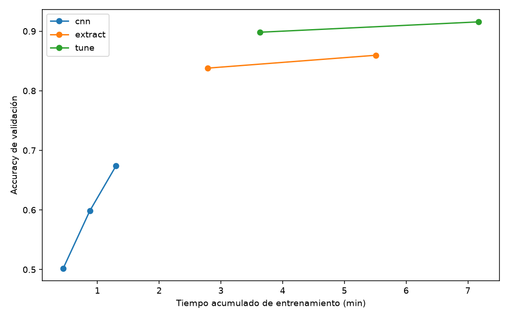
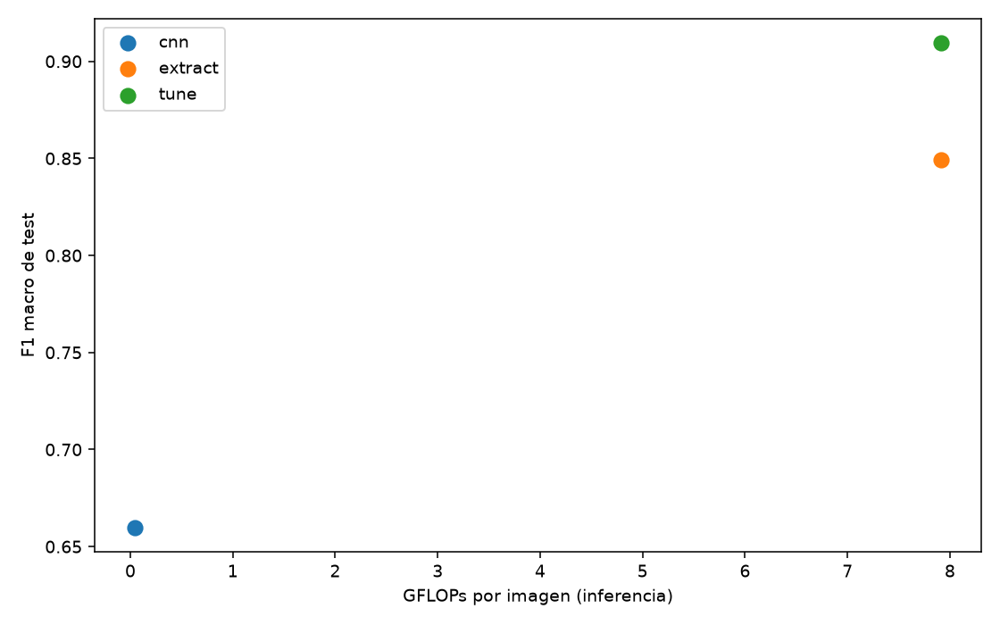

## Datos, método y herramientas

CIFAR-10 contiene 50 000 imágenes de entrenamiento y 10 000 de test, de 32×32 píxeles RGB en diez clases balanceadas con 5 000 ejemplos por clase. Se separaron 45 000 para entrenar y 5 000 para validar con estratificación y semilla 42. La media RGB de entrenamiento es (0,4911; 0,4821; 0,4464) y su desviación estándar (0,2469; 0,2434; 0,2616), frente a (0,485; 0,456; 0,406) y (0,229; 0,224; 0,225) en ImageNet. Gato/perro, ciervo/caballo y automóvil/camión parecen pares difíciles por sus formas y el detalle limitado.

La CNN usa tres bloques convolucionales, batch normalization, dropout y 32×32; ambas VGG usan 112×112 y normalización ImageNet. Pasar de 32 a 112 multiplica los píxeles por 12,25; a 224, por 49. Se eligió 112 por la GPU disponible, una NVIDIA GeForce RTX 4050 Laptop de 6 GiB. Solo entrenamiento recibe recortes aleatorios con relleno y reflejos horizontales: validación y test permanecen intactos.

`torchvision.models.vgg16(weights=VGG16_Weights.IMAGENET1K_V1)` carga los pesos; `weights.transforms()` define el preprocesamiento de referencia. Aquí se conserva la normalización ImageNet, pero se reemplazan el escalado y recorte de referencia por un redimensionamiento directo a 112×112. `model.features` contiene los cinco bloques convolucionales; `model.avgpool` es un `AdaptiveAvgPool2d` que entrega 7×7, y se reemplaza la última capa de `model.classifier` por diez salidas. Con `requires_grad=False` se congela `features` en extracción; en fine-tuning se descongela uno o dos bloques y `param_groups` asigna una tasa de aprendizaje menor al backbone. `model.train()` habilita dropout, `model.eval()` lo deshabilita y `torch.set_grad_enabled(False)` evita almacenar gradientes al evaluar, igual que `torch.no_grad()`.

Los parámetros totales incluyen los congelados y los entrenables solo aquellos con `requires_grad=True`. Un MAC aproxima una multiplicación más una suma, equivalentes a unos dos FLOPs. `torch.profiler.profile(with_flops=True)` estima los FLOPs de convoluciones y matrices, no de todas las operaciones; `torch.cuda.synchronize()` permite medir el tiempo tras completar los kernels y `torch.cuda.max_memory_allocated()` informa el pico de memoria de tensores. El entrenamiento se estima como un forward en capas congeladas más un forward y dos backward equivalentes en capas entrenables por imagen y época. Son aproximaciones, no conteos físicos exactos.

## Iteraciones y selección

La selección se hizo **solo por F1 macro de validación** y se conservó el mejor checkpoint de cada configuración. Solo los tres modelos finales se evaluaron en el test oficial; luego se entrenaron nuevamente desde su inicialización correspondiente con el 10 % estratificado del conjunto de entrenamiento.

| Iteración | Configuración distinta | Épocas | F1 validación | Tiempo total |
|:--|:--|--:|--:|--:|
| cnn_a | 24 canales base; dropout 0,2; LR 0,03 | 3 | 0,6760 | 83 s |
| cnn_b | 32 canales base; dropout 0,3; LR 0,03 | 3 | 0,6509 | 4 545 s* |
| cnn_c | 32 canales base; dropout 0,4; LR 0,01 | 3 | 0,6223 | 77 s |
| extract_a | backbone congelado; LR 0,003 | 2 | 0,8585 | 349 s |
| extract_b | backbone congelado; LR 0,001 | 2 | 0,8416 | 347 s |
| extract_c | backbone congelado; LR 0,0003 | 2 | 0,8202 | 357 s |
| tune_a | bloque 5; LR 0,001 / 0,0001 | 2 | 0,8837 | 421 s |
| tune_b | bloques 4–5; LR 0,001 / 0,0001 | 2 | **0,9152** | 446 s |
| tune_c | bloque 5; LR 0,0003 / 0,00003 | 2 | 0,8627 | 1 171 s* |

En fine-tuning, las dos tasas son las del clasificador y el backbone respectivamente. El tamaño de lote fue 128 para CNN, 32 para extracción y 16 para fine-tuning. El mejor checkpoint ocurrió en la última época de cada iteración. \*Los tiempos de `cnn_b` época 1 (4 491 s) y `tune_c` época 2 (956 s) son anomalías de ejecución: se conservan como fueron medidos, pero no se usan como tiempos típicos. Las nueve curvas de pérdida y las métricas por época están en el notebook.

## Comparación de desempeño y recursos

| Ganador | Parámetros totales / entrenables | FLOPs/img | GPU ms/img | s/época | Total | GPU pico |
|:--|--:|--:|--:|--:|--:|--:|
| CNN `cnn_a` | 0,163 M / 0,163 M | 0,044 G | 1,80 | 26,0 | 83 s | 0,10 GiB |
| Extracción `extract_a` | 134,302 M / 119,587 M | 7,912 G | 5,56 | 165,4 | 349 s | 1,86 GiB |
| Fine-tuning `tune_b` | 134,302 M / 132,566 M | 7,912 G | 5,80 | 215,2 | 446 s | 1,95 GiB |

Los tres ganadores alcanzaron su mejor validación en 3, 2 y 2 épocas, respectivamente. El costo total de entrenamiento estimado para esas épocas completas fue **0,018; 0,755 y 1,296 PFLOPs**. El profiler cuenta solo parte de las operaciones y la regla forward/backward es aproximada; la latencia es la media de 100 inferencias individuales en GPU después de diez ejecuciones de calentamiento. El tiempo total medido incluye validación y guardado, además del entrenamiento.

| Ganador | Test accuracy | Test precision | Test recall | Test F1 macro | F1 con 10 % |
|:--|--:|--:|--:|--:|--:|
| CNN | 0,6577 | 0,7033 | 0,6577 | 0,6598 | 0,3061 |
| Extracción | 0,8510 | 0,8522 | 0,8510 | 0,8494 | 0,7874 |
| Fine-tuning | **0,9103** | **0,9101** | **0,9103** | **0,9095** | **0,8423** |

Con el 10 % de datos, las accuracies de test fueron 0,3268, 0,7875 y 0,8417, respectivamente. Las precisiones y recalls macro completos de ese experimento, junto a las matrices de confusión, están en el notebook y en `results/`.

{width=64%}

{width=64%}

## Discusión y conclusiones

El fine-tuning obtuvo el mejor F1 de test, **0,0601** más que extracción y **0,2497** más que la CNN. Frente a extracción comparte tamaño y costo aproximado de inferencia, pero requiere 12,979 M más parámetros entrenables, unos 96 s adicionales en esta corrida y cerca de 72 % más cómputo total estimado de entrenamiento. Para un servidor con GPU, el aumento de F1 justifica elegirlo si importa la calidad. La CNN ofrece el menor consumo: alrededor de 180 veces menos FLOPs de inferencia que VGG, pero pierde bastante precisión. Si el límite principal es memoria o cómputo, es la mejor de estas tres para un dispositivo móvil; como alternativa preentrenada compacta se consideraría MobileNetV3.

Las primeras capas de VGG aprenden bordes y texturas que siguen siendo útiles en imágenes más pequeñas. El escalado a 112×112 no recupera detalle perdido, pero hace compatibles las formas espaciales con el clasificador; también eleva el cómputo respecto a 32×32. No se ensayó 224×224, por lo que no se puede atribuir una diferencia de F1 a ese tamaño. Descongelar dos bloques mejoró el F1 de validación frente a uno (0,9152 frente a 0,8837); con un bloque y una tasa menor cayó a 0,8627. Las curvas de dos épocas no permiten afirmar ni descartar olvido catastrófico, y no muestran una caída sostenida de validación que demuestre sobreajuste.

Al reducir los datos, el F1 de la CNN cayó **0,3537**, frente a **0,0620** en extracción y **0,0672** en fine-tuning. Esto favorece reutilizar pesos preentrenados con pocos datos; el fine-tuning conserva la mayor calidad absoluta, aunque extracción necesita menos entrenamiento. En test, la confusión principal de la CNN fue perro→gato (303 casos), además de camión→barco (168); en extracción fue gato→perro (179) y ciervo→caballo (65); en fine-tuning siguió dominando gato→perro (120), pero con menos casos. Los modelos comparten parte de los errores entre animales, aunque VGG reduce varias confusiones de vehículos y animales.
